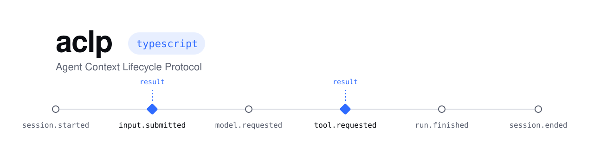

<h1 align="center">
  <picture>
    <source media="(prefers-color-scheme: dark)" srcset=".github/assets/banner-dark.svg">
    
  </picture>
</h1>

<p align="center">
  <a href="https://www.npmjs.com/package/@superaligned/aclp"></a>
  <a href="https://github.com/superaligned-to/aclp-ts/actions/workflows/check.yml"></a>
  <a href="https://github.com/superaligned-to/aclp"></a>
  <a href="LICENSE"></a>
</p>

The TypeScript package for the [Agent Context Lifecycle Protocol](https://github.com/superaligned-to/aclp): the `aclp` CLI that connects ACLP servers to your agent harnesses, and a client and callback server for building your own.

## Connect a harness

```sh
npx @superaligned/aclp install claude-code
npx @superaligned/aclp server add memory --url http://127.0.0.1:8788/aclp
npx @superaligned/aclp status
```

`install` shows the exact file changes and asks before writing. Hooks run a copy of the runtime in `~/.config/aclp/runtime`, never `npx`. `server add` reads the server's `/.well-known/aclp` document, signs you in with a token or OAuth when the server asks, and lets you choose which events it receives. Credentials stay in the OS keychain or a 0600 file, never in harness configuration.

A server that is down, times out or answers badly never blocks the harness, except where its reply guards an action: a failed `tool.requested` or `permission.requested` request denies that call, and every other request proceeds without the server's context. `--on-error allow` or `--on-error deny` on `server add` or `server events` applies one policy to all of a server's requests; the failure still shows in `status`.

| Support | Harnesses |
| --- | --- |
| Context before the model | Claude Code, Codex, OpenCode, Pi, OMP, Hermes Agent, Gemini CLI, Qwen Code, Factory Droid, Devin CLI, GitHub Copilot CLI, Kiro CLI, Amp, Cline CLI/SDK, OpenClaw |
| Observe only | Cursor, Windsurf, Auggie CLI, Goose, Crush |
| Model-initiated tool over MCP | Claude Desktop, ChatGPT Desktop, Zed |

Run `npx @superaligned/aclp help` for every command and flag.

## Build a server or client

```sh
pnpm add @superaligned/aclp
```

```ts
import { createClient, createServer, defineResult } from "@superaligned/aclp";

const context = defineResult<{ context: string[] }>({
  type: "object",
  properties: { context: { type: "array", items: { type: "string" } } },
  required: ["context"],
  additionalProperties: false,
});

const server = createServer({
  "input.submitted": {
    result: context,
    handle: () => ({ context: ["Prefer pure functions and immutable values."] }),
  },
});

await new Promise<void>((resolve) => server.listen(8787, "127.0.0.1", resolve));

const client = createClient({ url: "http://127.0.0.1:8787/events" });

const reply = await client.request("input.submitted", {
  sessionId: "session-1",
  content: [{ type: "text", text: "Create a TypeScript class." }],
}, context);
```

Notifications use `client.notify(method, params)` and `await client.flush()`. `onErrorFor(method, configured?)` gives the failure policy a harness applies to a request: `deny` for `tool.requested` and `permission.requested`, `allow` otherwise. The harness tooling (plan, install, registry, adapters) is exported from `@superaligned/aclp/hooks`.

## Development

```sh
pnpm install --frozen-lockfile
pnpm check
```

Licensed under [MIT](LICENSE).
